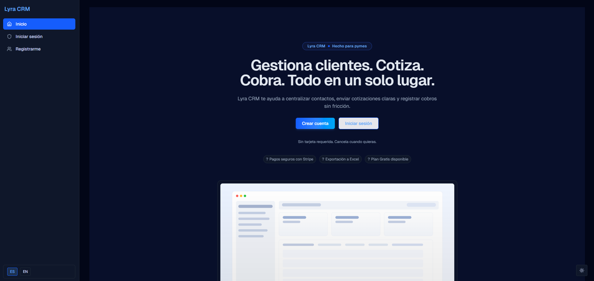
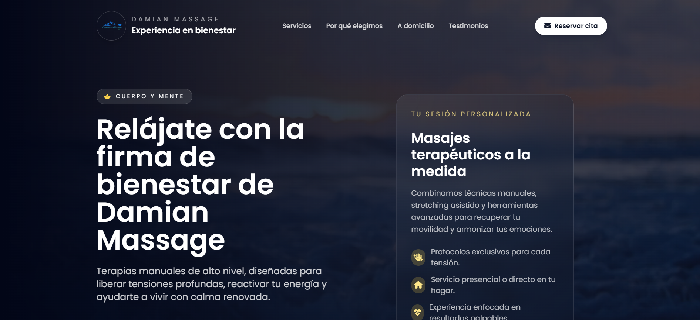
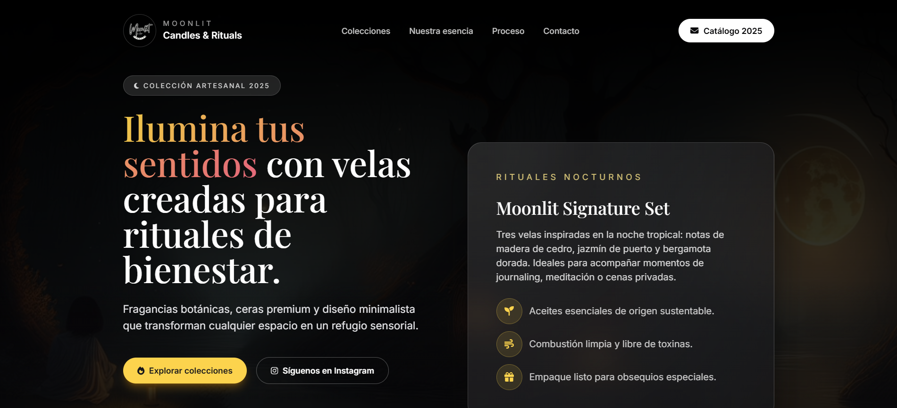
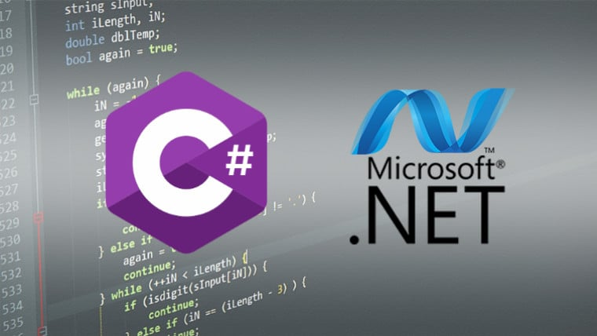
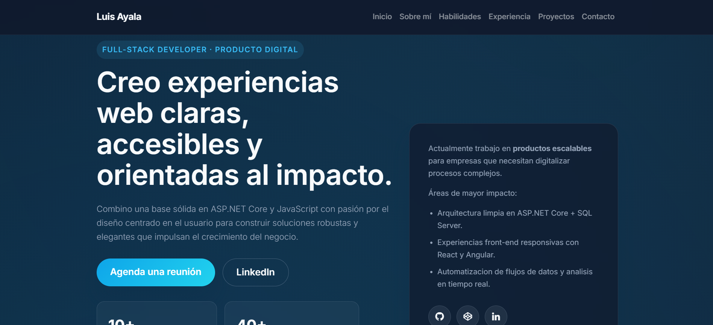

<h1>Luis A Ayala Rosa</h1>

Software developer building web applications and practical AI tools
I work across frontend and backend development, building web applications and software tools with technologies such as C#, .NET, Python, React, Next.js, and PostgreSQL. I am also exploring applied AI through projects involving assistants, data workflows, and retrieval-based systems.

<h2>Database</h2>

<h2>BackEnd</h2>

<h2>FrontEnd</h2>

<h2>Cloud and Deploy</h2>

<h2>Version Control</h2> 

<h2>IDE</h2> 

<h2>Game Code</h2> 

## Projects

<table>
  <tr>
    <td>
      
    </td>
    <td>
      <h3>AI CLI (Python)</h3>
      
python

      <strong>Technologies:</strong> 
       <a href="https://github.com/layalarosa/mini-cli">View project</a>
    </td>
  </tr>
  <tr>
    <td>
      
    </td>
    <td>
      <h3>Lyra Crm Saas</h3>
      
Saas React, Tailwind, Typescript, nextjs, postgres, supabase

      <strong>Technologies:</strong> 
       
      <a href="https://lyra-crm.com/">View project</a>
    </td>
  </tr>
  <tr>
    <td>
      
    </td>
    <td>
      <h3>Web</h3>
      
Web in Html, Css, Tailwind, Javascript

      <strong>Technologies:</strong> 
       
      <a href="https://damianmassage.netlify.app/">View project</a>
    </td>
  </tr>
  <tr>
    <td>
      
    </td>
    <td>
      <h3>Web</h3>
      
Web in Html, Css, Tailwind, Javascript

      <strong>Technologies:</strong> 
       
      <a href="https://moonlitcandles.netlify.app/">View project</a>
    </td>
  </tr>
  <tr>
    <td>
      
    </td>
    <td>
      <h3>Extract Data</h3>
      
Feature Extract Data Excel to Sql

      <strong>Technologies:</strong> 
       
      <a href="https://github.com/layalarosa/Files">View project</a>
    </td>
  </tr>
  <tr>
    <td>
      
    </td>
    <td>
      <h3>Ecommerce</h3>
      
Web Application MVC

      <strong>Technologies:</strong> 
       
       
      <a href="https://github.com/layalarosa/WebShop">View project</a>
    </td>
  </tr>
  <tr>
    <td>
      
    </td>
    <td>
      <h3>Porfolio</h3>
      
Web in Html, Css, Tailwind, Javascript

      <strong>Technologies:</strong> 
       
       
      <a href="https://layalarosa.netlify.app/">View project</a>
    </td>
  </tr>
</table>

     

